# Research Intelligence Studio — Agentic Paper Review System

> An AI-assisted research paper review system that helps evaluate manuscripts, examine research quality, and verify evidence against the original document.

[](https://www.python.org/)
[](https://fastapi.tiangolo.com/)
[](https://ollama.com/)
[-brightgreen.svg)]()
[](LICENSE)

---

## Project Overview

When reviewing scientific manuscripts, reading every paper carefully and checking its claims takes hours. While Large Language Models (LLMs) can help summarize and review research papers quickly, they have a big problem: they often sound confident while hallucinating criticisms, misquoting the authors, or inventing numbers that never existed in the paper.

I built **Research Intelligence Studio** to address this problem. It is a local-first, privacy-focused software system designed to help researchers, students, and peer reviewers read and evaluate academic papers.

Instead of just trusting what an AI model writes, Research Intelligence Studio pairs generative LLM evaluations with **deterministic evidence verification**:
1. When the AI makes an assessment or cites an excerpt from the paper, the system extracts the candidate quote.
2. It deterministically searches the original extracted PDF or DOCX text to confirm whether that quote actually exists verbatim.
3. If an evaluation lacks sufficient verified evidence, a built-in **Safety Gate** intercepts the result and flags the manuscript as **"Needs Manual Review"**.

The goal of this project is not to replace human peer reviewers. Academic publishing requires deep domain expertise and ethical responsibility. This project serves as an inspectable, transparent **reviewer's copilot** that saves time while keeping human judgment firmly in control.

---

## Application Screenshots

Here is what the interface looks like in action, running on real research manuscripts.

### 1. System Overview Dashboard
The main entry point provides workspace metrics, average diagnostic scores, paper throughput, and an upload area.
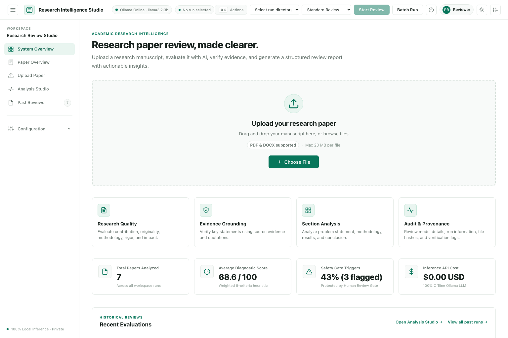

### 2. Manuscript Upload
Upload PDF or DOCX research manuscripts. The system computes a SHA-256 fingerprint for each file to automatically detect duplicates and prevent accidental re-runs.
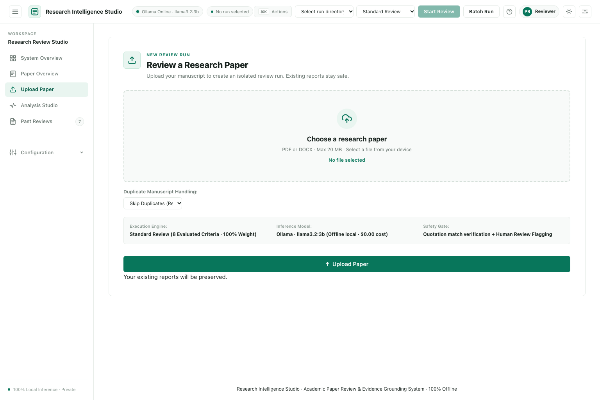

### 3. Structured Paper Overview
Before reading a review, reviewers get an 8-dimensional summary of the manuscript: research problem, objectives, methodology, contributions, experimental setup, key findings, stated limitations, and author-stated future work. An authoritative review strip at the top displays the run's evaluation score and quotation coverage.
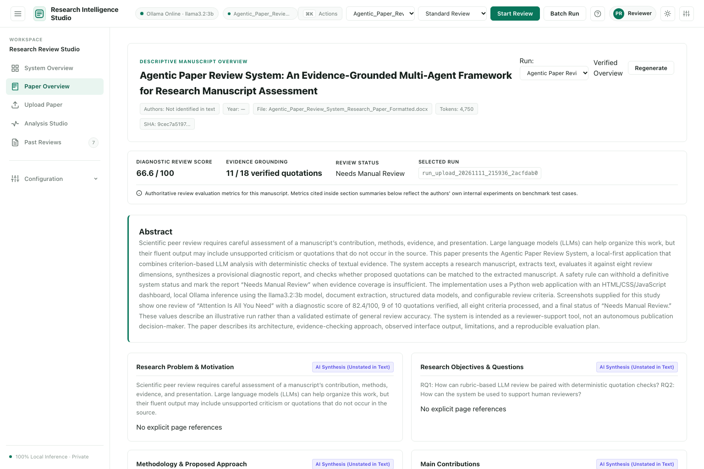

### 4. Analysis Studio
The central workspace displays the diagnostic review score, provisional recommendations, quotation verification coverage (e.g. 11/18 quotes verified), evaluation warnings, and an executive summary.
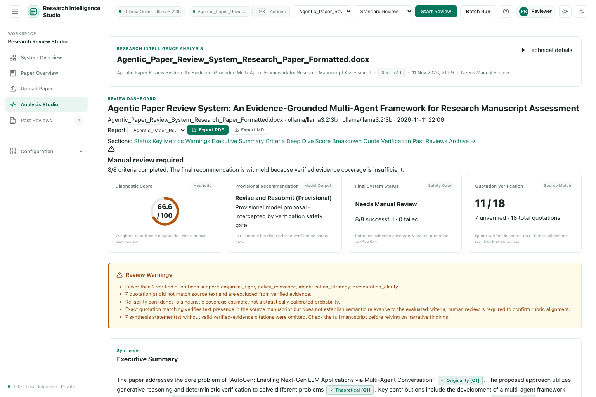

### 5. Grounding Matrix & Quotation Evidence
Clicking into the Grounding Matrix reveals the complete evidence audit trail. Reviewers can filter between verified and unverified quotes, see verbatim source excerpts, check which manuscript section each quote came from, and view the evaluator's justification.
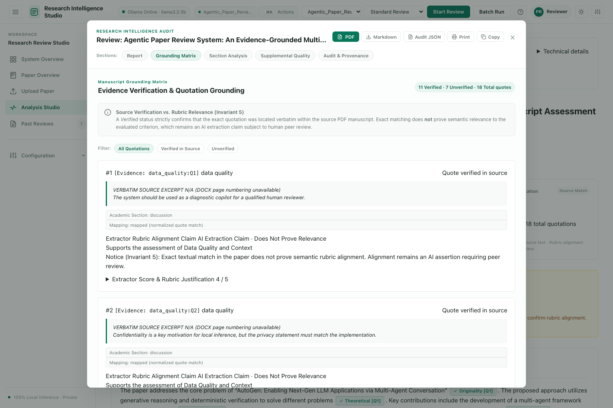

### 6. Full Publication Review Report
A complete, structured peer review report with radial score dials, categorized strengths, methodological concerns, and actionable revision suggestions tagged with interactive evidence badges.
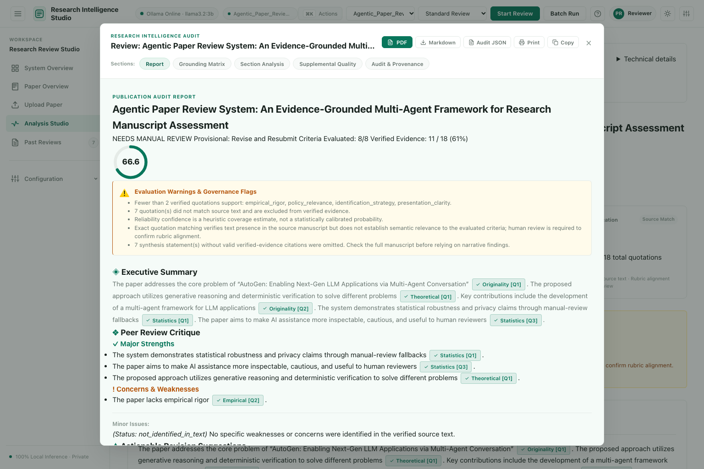

### 7. Section Analysis
Breaks down the manuscript structure section by section, analyzing whether the paper adheres to standard academic presentation standards.
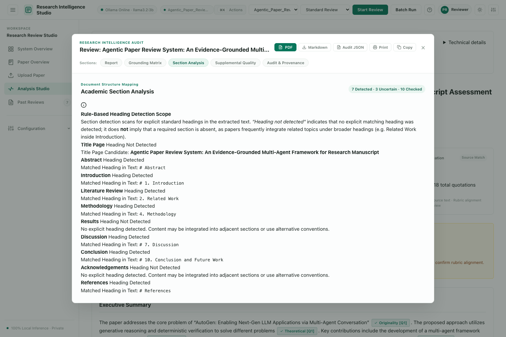

### 8. Supplemental Research Quality
Evaluates supplementary research rigor, statistical consistency, and methodological completeness.
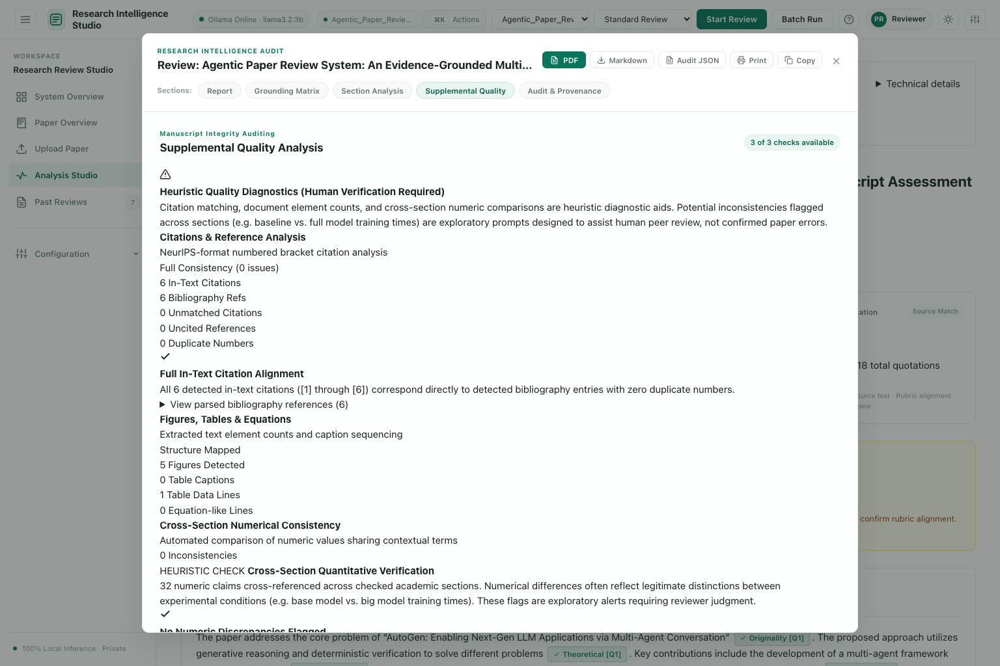

### 9. Audit & Provenance Inspector
Shows complete transparency for the review run: exact file SHA-256 hashes, model version (`llama3.2:3b`), run timestamp, token count, and verification logs.
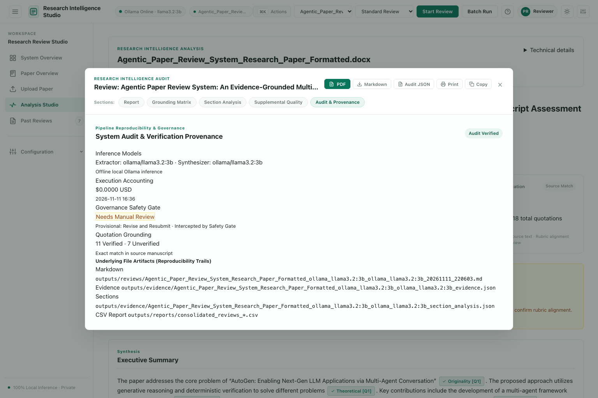

### 10. Past Reviews Archive
Browse, filter, search, compare, and manage past evaluations. Includes safe soft-delete and non-destructive trash recovery.
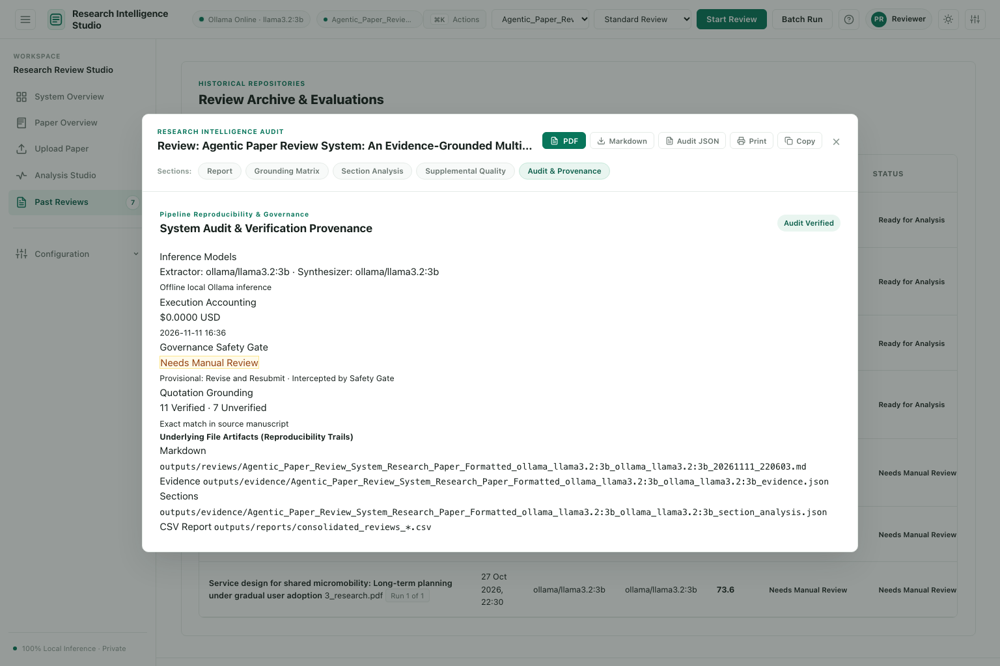

---

## Key Features

- **PDF & DOCX Support:** Upload academic papers in either standard PDF or Word DOCX formats.
- **Deterministic Content Extraction:** Uses PyMuPDF4LLM and MarkItDown to convert manuscripts into clean, structured Markdown while preserving headings, equations, and tables.
- **Multi-Agent Evaluation:** Specialized agents evaluate the paper across 8 review dimensions (Originality, Empirical Rigor, Theoretical Soundness, Methodology, Literature Context, Policy Relevance, Identification Strategy, and Presentation Clarity).
- **Deterministic Quotation Matching:** Checks candidate quotations against the actual manuscript text using exact and normalized substring search.
- **Evidence Grounding Matrix:** An interactive matrix mapping every verified quote to its corresponding manuscript section and rubric claim.
- **Safety Gate & Governance:** Automatically withholds publication recommendations and flags the report as **"Needs Manual Review"** if quotation verification coverage is below safety thresholds.
- **8-Dimensional Paper Overview:** Synthesizes structured breakdowns of the paper's core contributions, methods, experimental setup, and limitations with clear provenance tags.
- **100% Local & Offline Inference:** Runs entirely locally on your machine using Ollama with `llama3.2:3b`. No paper text or data ever leaves your computer, ensuring total privacy for unpublished research.
- **One-Click Export Options:** Export reports in PDF, Markdown, and structured JSON audit packages.
- **Non-Destructive Review Management:** Soft-delete reviews with full restoration from the Trash modal.

---

## Technology Stack

| Layer | Technology | Description |
| :--- | :--- | :--- |
| **Frontend** | Vanilla JavaScript (ES6+), HTML5, CSS3 | Clean, responsive SPA inspired by modern academic tools (Paperpal). No Node.js build step or npm dependencies required at runtime. |
| **Backend** | Python 3.10+, FastAPI, Uvicorn | High-performance asynchronous REST API and Server-Sent Events (SSE) streaming. |
| **Local LLM Inference** | Ollama, LiteLLM | Local offline inference with `llama3.2:3b`. Zero API cost, private, and fully reproducible. |
| **Document Processing** | PyMuPDF4LLM, MarkItDown, python-docx | High-fidelity text extraction from academic PDF and DOCX files. |
| **Storage & Data Flow** | File-based JSON & SHA-256 Run Isolation | Atomic writes with run-specific isolation. Each upload receives a unique SHA-256 directory. |
| **Testing & Quality** | Pytest, TestClient, Chrome CDP | 229 automated unit and regression tests covering ingestion, review logic, and frontend rendering. |

---

## System Architecture

The following diagram illustrates how Research Intelligence Studio processes a paper from initial upload to the final human-reviewed report:

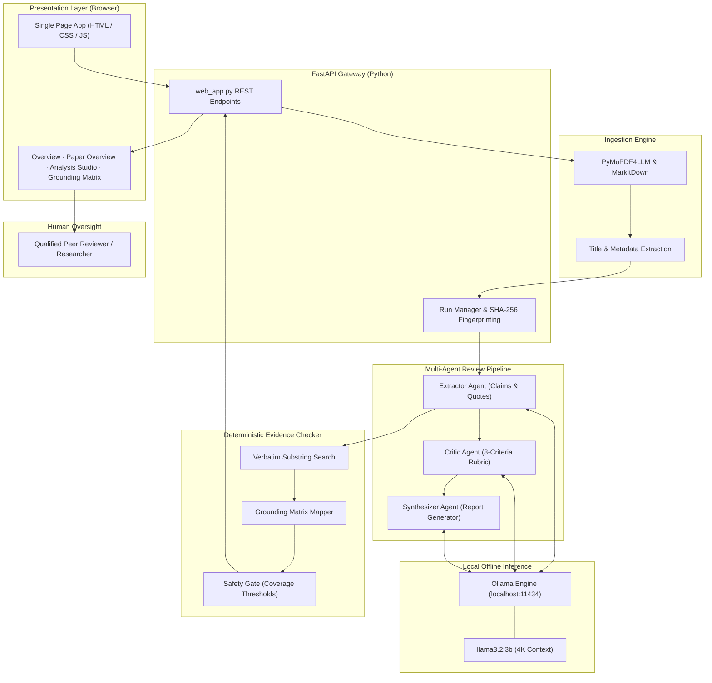

A standalone high-resolution SVG diagram is also available at [docs/architecture/architecture_diagram.svg](docs/architecture/architecture_diagram.svg).

### Key Architectural Concepts
1. **Isolated Run Directories:** Every manuscript upload is placed in its own timestamped and hashed folder (e.g. `run_upload_20261111_215936_2acfdab0`). Review outputs, caches, and progress files never leak between runs.
2. **Deterministic Evidence Checking:** Instead of asking the LLM "Did you make this up?", the backend takes the exact string generated by the Extractor agent and searches for a substring match in the extracted manuscript text.
3. **Safety Gate Invariant:** Exact quote matching verifies that text exists in the paper; it does not prove the author's argument is correct. When evidence is sparse, the safety gate enforces a **"Needs Manual Review"** decision.

---

## Application Workflow

```mermaid
flowchart LR
    A["1. Upload Manuscript (PDF / DOCX)"] --> B["2. Validate & Compute SHA-256"]
    B --> C["3. Extract Text & Structure Markdown"]
    C --> D["4. Map Academic Sections"]
    D --> E["5. Evaluate 8 Review Dimensions"]
    E --> F["6. Verify Quotes Against Source Text"]
    F --> G["7. Build Grounding Matrix"]
    G --> H["8. Safety Gate Check"]
    H --> I["9. Human Review & Decision"]
```

A standalone high-resolution SVG workflow diagram is available at [docs/architecture/workflow_diagram.svg](docs/architecture/workflow_diagram.svg).

---

## Project Structure

```
research-intelligence-studio/
├── agents/                       # Specialized AI review and extraction agents
│   ├── academic_section_analyzer.py      # Structural academic section mapper
│   ├── agent_critic.py                   # 8-criterion rubric scoring agent
│   ├── agent_extractor.py                # Candidate claim and quote extractor
│   ├── agent_fact_checker.py             # Deterministic quotation verifier
│   ├── agent_synthesizer.py              # Review synthesis and narrative generator
│   └── evidence_grounding.py             # Grounding matrix compilation logic
├── core/                         # Core ingestion, models, and utility modules
│   ├── config_loader.py                  # YAML and environment configuration loader
│   ├── data_models.py                    # Pydantic schemas for papers, runs, reviews
│   ├── paper_ingestor.py                 # PDF/DOCX parsers and title extraction
│   ├── paper_overview.py                 # 8-dimensional paper overview generator
│   └── progress.py                       # Progress tracking and run persistence
├── web/                          # Frontend single-page application
│   └── static/
│       ├── index.html                    # Single-page dashboard markup
│       ├── style.css                     # Design system (Paperpal-inspired academic UI)
│       └── app.js                        # Client state, routing, and modal managers
├── config/                       # Review criteria and rubric configurations
│   ├── criteria.yaml                     # Definition of 8 review criteria
│   └── model_costs.yaml                  # Model cost and token usage parameters
├── docs/                         # Documentation and visuals
│   ├── architecture/                     # Architecture and workflow SVG diagrams
│   └── screenshots/                      # Real application screenshots
├── tests/                        # Comprehensive test suite (229 tests)
│   ├── test_data_consistency_audit.py    # Title healing & run isolation tests
│   ├── test_pdf_quote_matching.py        # Deterministic quotation matching tests
│   ├── test_phase5_paper_overview.py     # Paper overview generation tests
│   └── ...                               # Agent, API, and safety gate tests
├── web_app.py                    # Main FastAPI application and API routes
├── requirements.txt              # Python project dependencies
├── pytest.ini                    # Pytest configuration
└── README.md                     # Project documentation
```

---

## Installation and Setup

### Prerequisites
- **Python:** Version 3.10, 3.11, or 3.12 (Python 3.14 compatible).
- **Ollama:** Installed and running locally.
- **Operating System:** macOS, Linux, or Windows (WSL recommended for Windows).

---

### Step 1: Clone the Repository
```bash
git clone https://github.com/codeswith-pawan/research-intelligence-studio.git
cd research-intelligence-studio
```

### Step 2: Set Up Python Virtual Environment
**On macOS / Linux:**
```bash
python3 -m venv .venv
source .venv/bin/activate
```

**On Windows (PowerShell):**
```powershell
python -m venv .venv
.venv\Scripts\Activate.ps1
```

### Step 3: Install Dependencies
```bash
pip install --upgrade pip
pip install -r requirements.txt
```

### Step 4: Install Ollama & Pull the Model
Download Ollama from [ollama.com](https://ollama.com).

Start the Ollama service:
```bash
ollama serve
```

In another terminal, pull the required model:
```bash
ollama pull llama3.2:3b
```

Verify that Ollama is ready:
```bash
curl http://localhost:11434/api/tags
```

### Step 5: Start Research Intelligence Studio
```bash
python web_app.py --port 8050
```

Open your browser and navigate to:
```
http://localhost:8050
```

---

## Running the Automated Test Suite

The repository includes a comprehensive automated test suite testing document extraction, agent logic, deterministic quotation verification, safety gates, and API routes.

Run the full test suite with:
```bash
pytest -q
```

**Verified Test Results:**
```
229 passed in 5.52s (100% pass rate)
```

To run a specific test group (for example, the data consistency audit):
```bash
pytest -v tests/test_data_consistency_audit.py
```

---

## Current Limitations

Honesty about software limitations is essential in academic tools:

1. **AI is a Reviewer's Copilot, Not an Autonomous Judge:** The system generates heuristic scores and flags potential weaknesses. It does not replace the critical judgment, domain expertise, and contextual knowledge of qualified human reviewers.
2. **Context Window Boundaries:** The default local model (`llama3.2:3b`) runs with a 4K token context window. Very long manuscripts rely on structured section sampling.
3. **Verbatim Matching vs. Semantic Truth:** The deterministic evidence checker confirms that an excerpt appears word-for-word in the manuscript. It cannot independently determine whether the author's underlying experiment was scientifically valid or honest.
4. **Local Single-User Architecture:** Designed for local desktop and lab use on `localhost`. It does not include multi-user accounts, passwords, or cloud database sync. Keep it local and do not expose the port to the public internet without authentication.

---

## Future Improvements

- [ ] Support for larger local models (`llama3.3:70b`, `qwen2.5:14b`, `deepseek-r1`) via configurable hardware profiles.
- [ ] OCR extraction support for scanned image-based PDF manuscripts.
- [ ] Crossref and Semantic Scholar integration for live citation validation and literature context.
- [ ] Multi-reviewer collaborative annotations and side-by-side manuscript viewing.

---

## Author & Academic Information

- **Author:** Pawan Kumar Sharma
- **Academic Enrollment:** Roll No. 2330166
- **GitHub:** [@codeswith-pawan](https://github.com/codeswith-pawan)
- **Repository:** [https://github.com/codeswith-pawan/research-intelligence-studio](https://github.com/codeswith-pawan/research-intelligence-studio)

---

## License

This project is licensed under the [MIT License](LICENSE).
