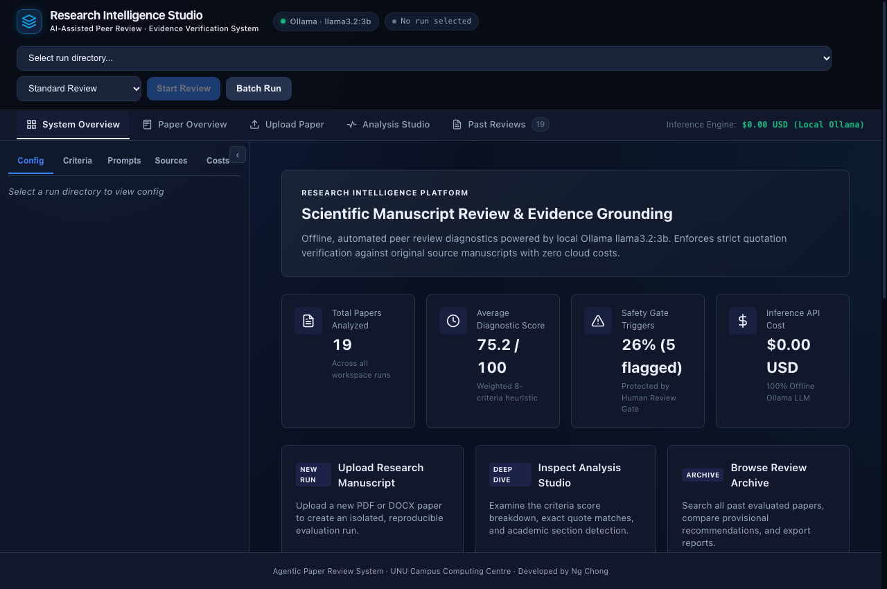
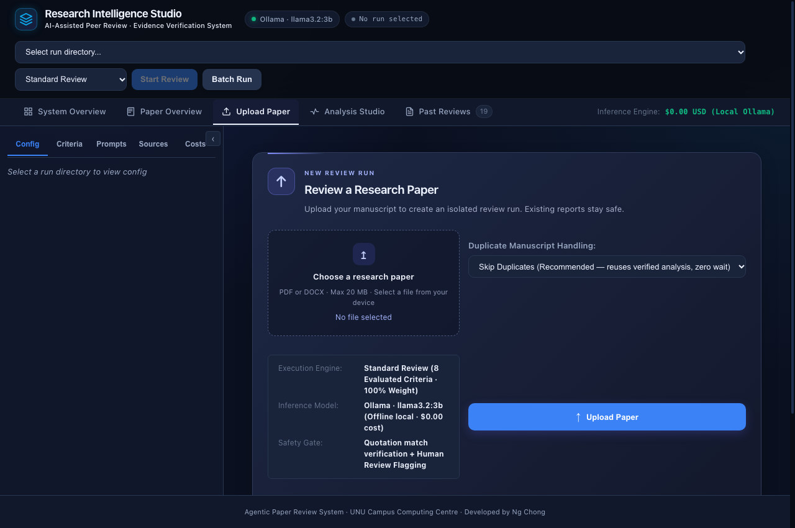
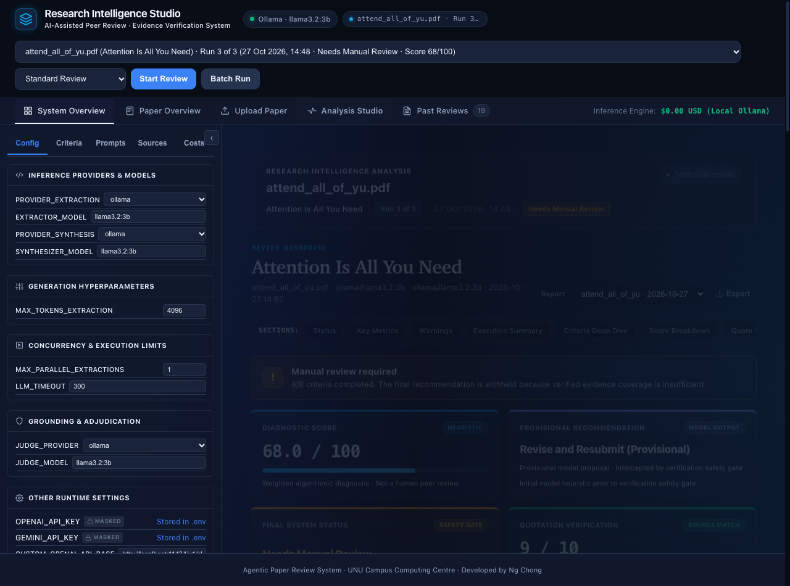
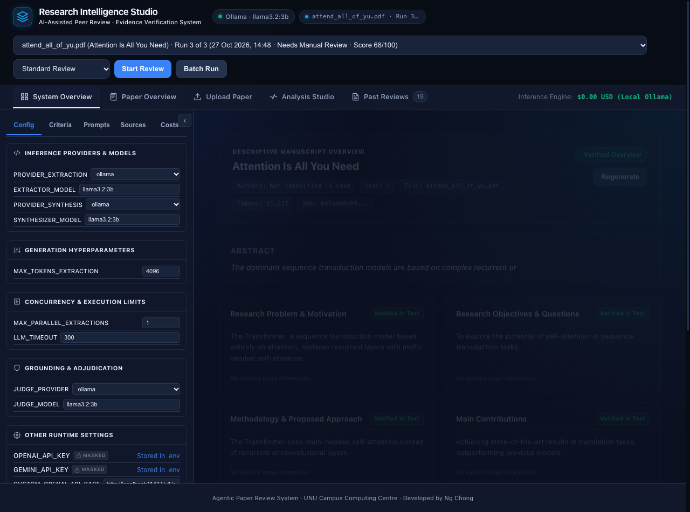

# Research Intelligence Studio: Agentic Paper Review System

A domain-agnostic, multi-agent LLM system for structured, evidence-grounded academic paper review. Ingests manuscripts in PDF and DOCX formats, evaluates each paper against customizable rubrics, verifies quotations directly against extracted source text, and produces multidimensional reviews, audit packages, and structured 8-dimensional paper overviews.

> **Human Oversight Philosophy**<br>
> The system is designed as an intelligent reviewer's copilot, not an autonomous decider. It computes heuristic diagnostic evaluations and surfaces potential methodological weaknesses or ungrounded claims. Final acceptance decisions remain strictly with human reviewers.

---

## Key Features

- **Multi-Agent Evaluation Pipeline:**
  - **Specialist Agent:** Reads the manuscript criterion-by-criterion, extracting quantitative scores and verbatim supporting quotes.
  - **Synthesizer Agent:** Assembles holistic assessments, enforces conservative missing-section handling, and structures recommendations.
  - **Fact-Checker & Librarian Agents:** Assesses claim validity and novelty against baseline academic literature (Arxiv, Semantic Scholar).
  - **Critic Agent:** Conducts research trajectory analysis and novelty-adjusted scoring.
- **Dedicated Paper Overview Tab:** Provides an 8-dimensional manuscript breakdown (Research Problem, Objectives, Methodology, Main Contributions, Experimental Setup, Key Results, Stated Limitations, and Future Work) using reference-aware 3-part sampling.
- **Strict Evidence Grounding & Safety Gates:** Every factual claim is mapped to verified verbatim quotes. If any quote fails conservative exact-text verification, the review is automatically routed to the safety gate (status: **"Needs Manual Review"**; internal flag: `MANUAL_REVIEW`).
- **Batch Processing & Duplicate Prevention:** Multi-file queue with SHA-256 fingerprinting that automatically detects and skips identical manuscripts (`skip` vs `force_new` policies).
- **Safe Soft-Deletion & Lossless Trash Recovery:** Allows non-destructive deletion and restoration of reviews with complete artifact preservation.
- **Audit Provenance Export:** One-click export of structured JSON packages (`audit_{paper}.json`) containing full evidence trails, section analyses, citation checks, and quality diagnostics.

---

## Architecture & Tech Stack

- **Backend:** FastAPI (Python 3.10+)
- **Inference Engine:** Local Ollama (`llama3.2:3b`) via LiteLLM
- **Document Ingestion:** PyMuPDF, MarkItDown, python-docx
- **Event Streaming:** Server-Sent Events (SSE) via `sse-starlette`
- **Frontend:** Vanilla JavaScript, HTML5, CSS3 (No Node.js build step required)
- **Testing:** Pytest (207 automated regression and unit tests)

```
[Uploaded Manuscript (PDF/DOCX)]
               │
               ▼
   [Paper Ingestion Engine]
  (PyMuPDF / MarkItDown / DOCX)
               │
               ├────────────────────────────────────────┐
               ▼                                        ▼
    [Specialist Extractor]                    [Paper Overview Engine]
 (Criterion-by-criterion analysis)          (8-dimensional synthesis)
               │                                        │
               ▼                                        ▼
    [Synthesizer & Critic]                     [Paper Overview Tab]
   (Score calculation & gates)
               │
               ▼
[Analysis Studio / Past Reviews / Audit Export]
```

---

## Prerequisites & Local Setup

### 1. Install Ollama & Pull the Model (macOS / Linux)
Download and install Ollama from [ollama.com](https://ollama.com) or install via terminal:

```bash
# Install Ollama
curl -fsSL https://ollama.com/install.sh | sh

# Pull the lightweight local model
ollama pull llama3.2:3b
```

Verify that the Ollama service is active and the model is loaded:
```bash
curl http://127.0.0.1:11434/api/tags
```

### 2. Set Up Virtual Environment & Dependencies
*(Note: Repository URL will be configured upon release. For local setup, run these commands from the project root directory.)*

```bash
# Create and activate virtual environment
python3 -m venv .venv
source .venv/bin/activate

# Install required dependencies
pip install -r requirements.txt
```

### 3. Configure Local Environment
Copy the example configuration:
```bash
cp .env_example .env
```

Ensure `.env` contains local Ollama defaults:
```env
PROVIDER_EXTRACTION=ollama
EXTRACTOR_MODEL=llama3.2:3b
PROVIDER_SYNTHESIS=ollama
SYNTHESIZER_MODEL=llama3.2:3b
JUDGE_PROVIDER=ollama
JUDGE_MODEL=llama3.2:3b
TEMPERATURE=0.2
MAX_RETRIES=3
MAX_PARALLEL_EXTRACTIONS=1
LLM_TIMEOUT=300
```

---

## Running the Application

### Launch the Web Dashboard
```bash
# Activate virtual environment
source .venv/bin/activate

# Start dashboard
python web_app.py --port 8050
```

Open **`http://localhost:8050`** in your browser.

### Running via Command Line
```bash
# Set up a run directory
python setup_run.py --run-dir my_review_run

# Drop a PDF into my_review_run/papers/ and run:
python run_review_with_dir.py --run-dir my_review_run
```

---

## Automated Test Suite

The test suite covers full regression verification across all five phases:
- Navigation and audit provenance export
- Soft-delete, trash isolation, and lossless restoration
- Batch queue persistence, retry logic, and restart recovery
- Synthesis contract, missing-section truthfulness, and safety gates
- Dedicated 8-dimensional Paper Overview extraction and caching
- DOCX and PDF verbatim quotation verification

Run all 207 tests:
```bash
pytest -v
```

---

## Screenshots

### System Overview
High-level system statistics, diagnostic scoring distributions, and activity monitoring:


### Manuscript Upload & Deduplication
File staging supporting PDF and DOCX with SHA-256 duplicate detection:


### Analysis Studio
Live multi-agent review execution, 3-tier governance scoring, criteria deep-dive, and safety gate indicators:


### Dedicated Paper Overview
Structured 8-dimensional manuscript breakdown with truthful missing-information handling:


---

## Known Limitations & Design Boundaries

- **Local Demonstration Scope:** Designed specifically for single-user local evaluation and lab demonstration. It **does not include** multi-user session management, authentication, or tenant data isolation.
- **Do Not Expose to Open Internet:** The web server has no authentication layer. Run only on `localhost` or behind an authenticated VPN / SSH tunnel.
- **Local Model Context Bounds:** The `llama3.2:3b` model operates with a 4K active context window; long papers rely on targeted 3-part section sampling.
- **Rubric Specialization:** Default criteria are tuned for empirical methodology. Criteria can be edited in `config/criteria.yaml` for other academic disciplines.

---

## License

[MIT License](LICENSE)
